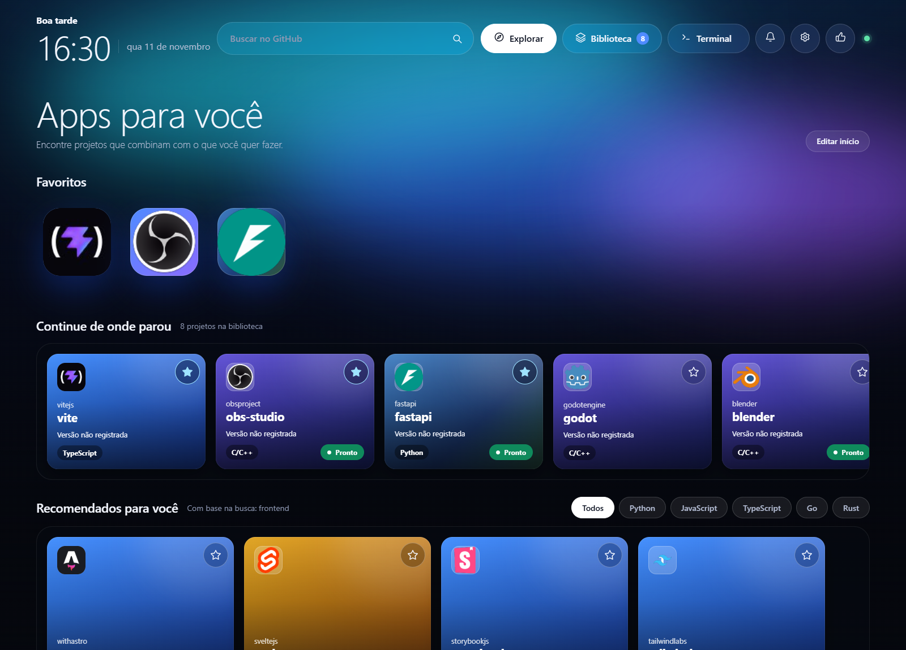
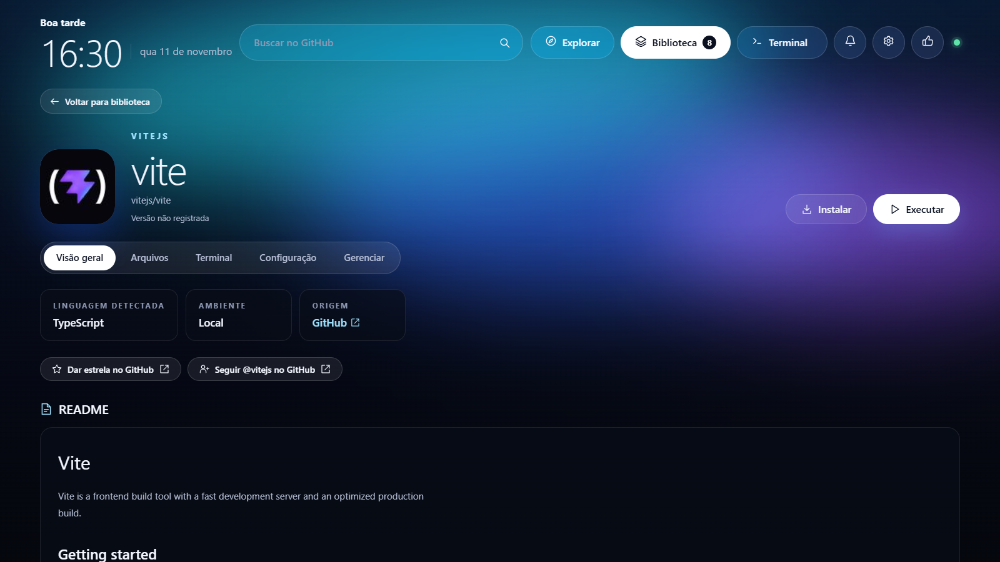

<p align="center"></p>

# Orbit

**Encontre, organize e execute projetos públicos do GitHub em um aplicativo de desktop.**

[English](docs/README.en.md) · [Baixar Orbit](https://github.com/heymahh/Orbit/releases/latest) · [Reportar um problema](https://github.com/heymahh/Orbit/issues/new)



O Orbit reúne descoberta, instalação e execução em uma biblioteca local. Procure um projeto pelo nome ou cole a URL do repositório. O Orbit procura uma Release compatível com seu sistema e pode recorrer ao código-fonte quando ela não existe. Para projetos executáveis, identifica o ambiente, prepara as dependências e mostra a saída no terminal.

## Baixar e instalar

Abra a [release mais recente](https://github.com/heymahh/Orbit/releases/latest) e escolha o pacote do seu sistema em **Assets**.

| Sistema | Pacote | Como abrir |
| --- | --- | --- |
| Windows x64 | Instalador `.exe` | Execute o instalador e abra **Orbit** pelo menu Iniciar. |
| Linux x64 | `.deb` para Debian e Ubuntu compatíveis | Instale pelo gerenciador de pacotes e abra **Orbit** pelo menu de aplicativos. |
| macOS | `.dmg` ou `.zip` para Apple Silicon (`arm64`) e Intel (`x64`) | Abra o DMG ou extraia o ZIP e mova o Orbit para **Aplicativos**. |

Os pacotes desktop já incluem o runtime do Orbit. Mantenha o **Git** instalado para baixar código-fonte. Alguns projetos exigem Node.js, Python, outras ferramentas locais ou Docker. Consulte **Ambientes** para ver o que o Orbit detectou.

Os primeiros pacotes Windows e macOS são distribuídos sem assinatura de distribuidor. O macOS também está sem notarização. O sistema pode exibir um aviso de origem. As próximas versões estarão disponíveis no GitHub Releases.

## Primeiros passos

1. Use a busca no topo de **Explorar** ou abra **Biblioteca → Adicionar projeto** e cole uma URL pública do GitHub.
2. Escolha **Baixar projeto**. Quando houver opções, confira o pacote, a versão e a pasta antes de continuar.
3. Na página do projeto, leia o README e escolha **Instalar** para preparar o ambiente ou **Executar** para iniciar. A primeira execução local pede sua autorização.
4. Acompanhe o andamento em **Terminal**. Use **Cancelar** durante a preparação ou **Parar** para encerrar um app em execução.

## O que você pode fazer

- **Personalizar o início.** Favorite projetos, crie categorias e use **Editar início** para reorganizar os ícones e escolher os widgets visíveis.
- **Descobrir projetos.** Veja recomendações e um ranking semanal de repositórios criados nos últimos sete dias, ordenados por estrelas.
- **Acompanhar versões.** Consulte a versão instalada ou baixada no card e veja quando uma nova Release está disponível. Atualize pela interface quando houver um pacote compatível.
- **Organizar a biblioteca.** Selecione vários projetos para favoritar, remover ou desinstalar. Em **Gerenciar**, consulte ou mova a instalação e, no Windows, abra a pasta pelo Explorador.
- **Inspecionar um projeto.** Leia o README, navegue pelos arquivos locais e acompanhe os logs. A disponibilidade de execução depende do projeto e da plataforma.
- **Continuar na bandeja.** Em **Ambientes → Sobre o Orbit**, escolha se fechar a janela mantém o app rodando em segundo plano.

### Biblioteca


### Página de um projeto



As capturas mostram o Orbit com uma biblioteca de demonstração. A interface desta versão está em português do Brasil.

## Como o Orbit escolhe o ambiente

Quando encontra um pacote publicado compatível, o Orbit oferece a Release para download ou instalação, conforme o formato. Quando usa o código-fonte, procura um plano local nos arquivos do projeto. Usa Docker quando o perfil depende de contêiner, quando você escolhe esse ambiente ou quando o plano disponível para o projeto requer Docker.

O Orbit grava a biblioteca no computador. A versão para navegador usa `.orbit/` por padrão e a versão desktop usa a pasta de dados do aplicativo. Comandos locais usam as permissões da sua conta. Consulte o README e a configuração antes de executar um projeto desconhecido.

## Rodar a partir do código

Você precisa de **Node.js 22+** e **Git**.

```sh
git clone https://github.com/heymahh/Orbit.git
cd Orbit
npm ci
npm run desktop
```

Use `npm start` para abrir a interface no navegador em `127.0.0.1:4310`. A versão desktop usa a porta local `4311`. Em caso de limite na API pública do GitHub, configure `GITHUB_TOKEN` no ambiente do processo antes de iniciar o Orbit. Mantenha o token fora dos arquivos do repositório.

| Tarefa | Comando |
| --- | --- |
| Verificar o cliente e a sintaxe | `npm run check` |
| Rodar os testes | `npm test` |
| Gerar o instalador Windows no Windows | `npm run dist:win` |
| Gerar o pacote Linux no Linux | `npm run dist:linux` |
| Gerar os pacotes macOS no macOS | `npm run dist:mac` |

Os pacotes ficam em `dist/`. O workflow [Build desktop packages](.github/workflows/build-desktop.yml) também compila os três sistemas no GitHub Actions. Os dados locais em `.orbit/` ficam fora do repositório.

## Apoiar o Orbit

O Orbit é gratuito. Se quiser apoiar o desenvolvimento, clique no joinha no topo do aplicativo. O modal **Apoiar o Orbit** oferece **Pix**, **BTC via BNB Smart Chain (BEP20)** e **ETH via Ethereum (ERC20)**. Para Pix, escaneie o QR Code ou copie o código e escolha o valor no app do seu banco.

Chave Pix para copiar manualmente

```text
bfd3db4d-75f3-4f61-a50a-311c33fdbfef
```
