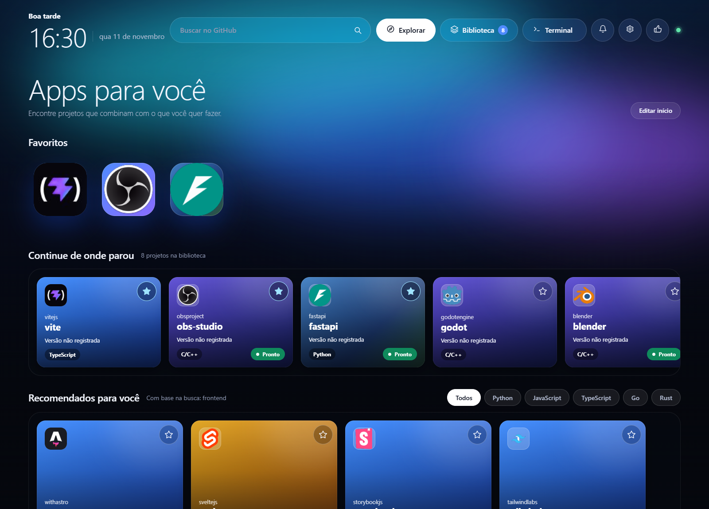
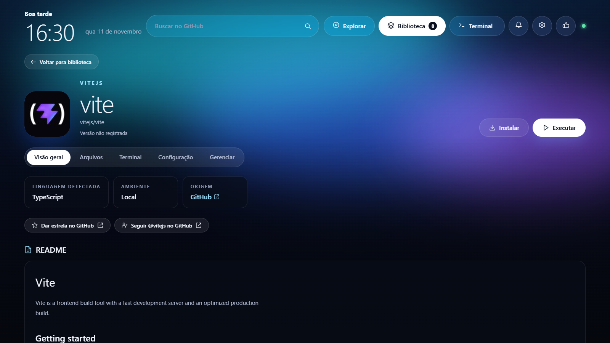

[Português (Brasil)](../README.md) · [Download Orbit](https://github.com/heymahh/Orbit/releases/latest) · [Report an issue](https://github.com/heymahh/Orbit/issues/new)

# Orbit

**Discover, organize, and run public GitHub projects from a desktop app.**



Orbit brings discovery, installation, and execution into a local library. Search for a project or paste its repository URL. Orbit looks for a Release that matches your system and can fall back to source code when a compatible Release is unavailable. For runnable projects, it detects the environment, prepares dependencies, and displays terminal output.

## Download and install

Open the [latest release](https://github.com/heymahh/Orbit/releases/latest) and choose the package for your system under **Assets**.

| System | Package | How to open |
| --- | --- | --- |
| Windows x64 | `.exe` installer | Run the installer, then open **Orbit** from the Start menu. |
| Linux x64 | `.deb` for compatible Debian and Ubuntu systems | Install it with your package manager, then open **Orbit** from the application menu. |
| macOS | `.dmg` or `.zip` for Apple Silicon (`arm64`) and Intel (`x64`) | Open the DMG or extract the ZIP, then move Orbit to **Applications**. |

Desktop packages include the Orbit runtime. Install **Git** to download source code. Individual projects may require Node.js, Python, other local tools, or Docker. Open **Ambientes** in the app to see which tools Orbit detected.

The first Windows and macOS packages ship without a distributor signature. The macOS packages are also unnotarized. Your system may display a warning about the app’s origin. Future versions will be available through GitHub Releases.

## First steps

1. Search from **Explorar**, or open **Biblioteca → Adicionar projeto** and paste a public GitHub URL.
2. Choose **Baixar projeto**. When choices are available, review the package, version, and destination before continuing.
3. Read the project's README, then choose **Instalar** to prepare the environment or **Executar** to start it. Orbit asks you to authorize the first local run.
4. Follow progress in **Terminal**. Choose **Cancelar** during preparation or **Parar** to stop a running app.

## Features

- **Customize your home.** Add favorites, create categories, and use **Editar início** to rearrange shortcuts and choose which widgets are visible.
- **Discover projects.** Browse recommendations and a weekly ranking of repositories created in the last seven days, sorted by GitHub stars.
- **Track versions.** See the installed or downloaded version on project cards and get notified when a new Release is available. Update from Orbit when a compatible package is offered.
- **Organize the library.** Select multiple projects to favorite, remove, or uninstall. Open **Gerenciar** to inspect or move an installation and, on Windows, open its folder in File Explorer.
- **Inspect a project.** Read its README, browse local files, and follow its logs. Execution support depends on the project and the platform.
- **Keep Orbit in the tray.** In **Ambientes → Sobre o Orbit**, choose whether closing the window keeps the app running in the background.

### Library


### Project details



The screenshots show Orbit with a sample library. This release's interface is in Brazilian Portuguese.

## How Orbit picks an environment

When Orbit finds a compatible published package, it offers that Release for download or installation, depending on its format. When it uses source code, it looks for a local execution plan in the project's files. Orbit uses Docker when a profile depends on a container, when you select Docker, or when the available plan requires Docker.

Orbit stores your library on your computer. The browser version defaults to `.orbit/`, and the desktop version uses the application's data directory. Local commands run with your account permissions. Review the README and configuration before running an unfamiliar project.

## Run from source

Install **Node.js 22+** and **Git**.

```sh
git clone https://github.com/heymahh/Orbit.git
cd Orbit
npm ci
npm run desktop
```

Run `npm start` to open the browser UI on `127.0.0.1:4310`. The desktop version uses local port `4311`. If you hit the GitHub public API rate limit, set `GITHUB_TOKEN` in the process environment before launching Orbit. Keep the token out of repository files.

| Task | Command |
| --- | --- |
| Check the client build and syntax | `npm run check` |
| Run the test suite | `npm test` |
| Build the Windows installer on Windows | `npm run dist:win` |
| Build the Linux package on Linux | `npm run dist:linux` |
| Build the macOS packages on macOS | `npm run dist:mac` |

Packages are written to `dist/`. The [Build desktop packages](../.github/workflows/build-desktop.yml) workflow also builds all three platforms in GitHub Actions. Local `.orbit/` data stays outside the repository.

## Support Orbit

You can support the project by starring it on GitHub, sharing Orbit, or submitting feedback and bug reports. Financial support can be enabled through GitHub Sponsors once the profile is approved.

[View the repository](https://github.com/heymahh/Orbit) · [Send feedback or report an issue](https://github.com/heymahh/Orbit/issues/new)
